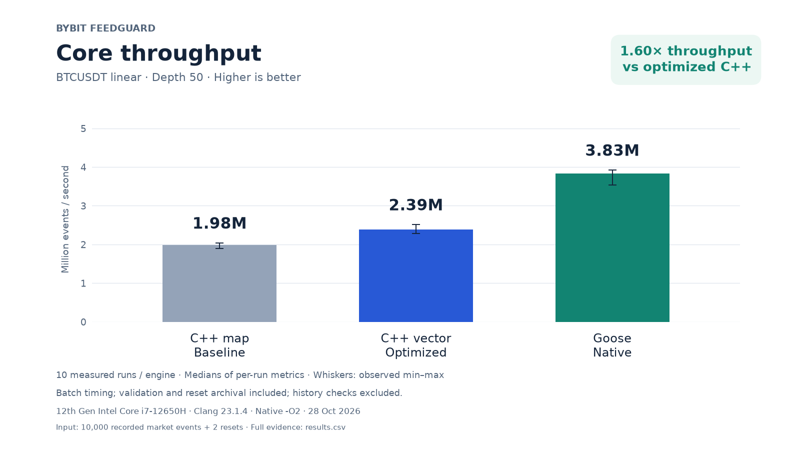
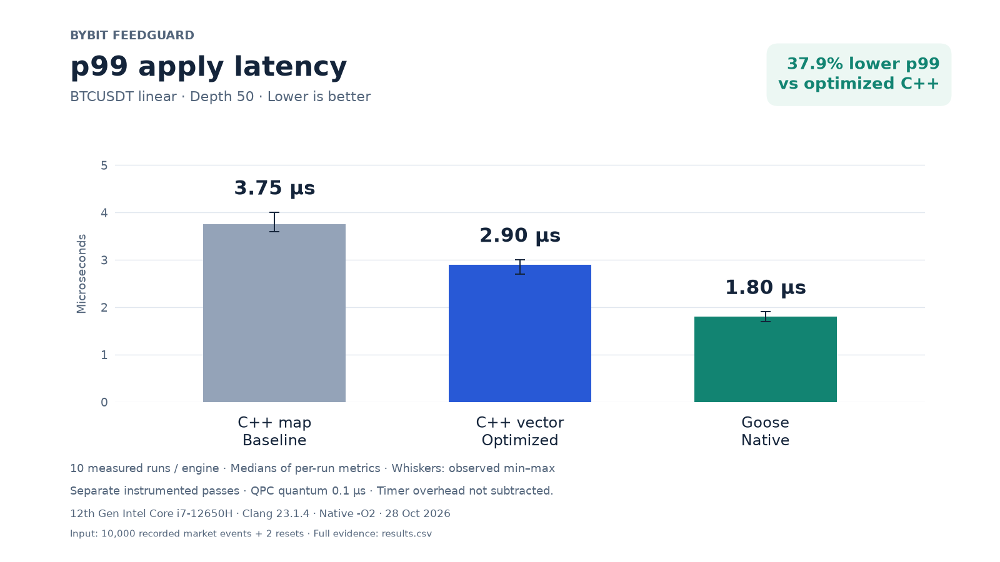

# Bybit FeedGuard

A reproducible Windows x64 prototype for collecting Bybit L2 market data and comparing three order-book engines: C++ `std::map`, optimized C++ sorted vectors, and native [Goose](https://github.com/aardappel/goose).

The repository includes recorded BTCUSDT linear depth-50 messages, exact integer normalization, versioned binary input, correctness tests, native engines, and the measured evidence behind the charts.

## Measured result

Intel Core i7-12650H, Clang 23.1.4, native `-O2`, 28 October 2026. Ten measured runs per engine and mode after warmup.

| Engine | Core events/sec | p99 apply latency | Maximum process peak RAM |
|---|---:|---:|---:|
| C++ map | 1,981,440 | 3.75 us | 8.643 MB |
| C++ vector | 2,389,914 | 2.90 us | 8.630 MB |
| Goose | 3,831,108 | 1.80 us | 7.664 MB |

On this workload, Goose achieved **1.60x the median throughput of optimized C++**, with a **37.9% lower median per-run p99** in separate instrumented passes. These observations apply to this implementation, dataset, machine, and build configuration.





Throughput excludes per-event clocks; latency is measured separately and includes timer overhead. Peak RAM is the whole-process Peak Working Set. The QPC quantum is 100 ns. Offline results and synthetic stress results are reported separately.

[Technical report](docs/technical_report.md) · [Reproduction guide](docs/reproduction.md) · [Binary specification](docs/binary_format.md) · [Measured CSV](results/stage7-20261028/results.csv) · [Pilot proposal draft](docs/pilot_proposal.md)

## Verify the shipped evidence

Python's standard library is enough for the evidence audit. From a clean checkout or extracted review bundle:

```powershell
python benchmark/prepare_datasets.py
python benchmark/audit_results.py results/stage7-20261028 --portable --output build/shipped-evidence-audit.json
python scripts/validate_capture.py data/raw/btcusdt-20261027-linear-x25519.jsonl --expected 10000
python scripts/verify_normalized.py data/normalized/events.bin data/raw/btcusdt-20261027-linear-x25519.jsonl data/metadata/btcusdt-linear-20261027.json
```

Run `prepare_datasets.py` once; it refuses to replace an existing generated dataset directory. It reconstructs the labelled synthetic workload byte-for-byte. Portable audit verifies the CSV, raw responses, latency distributions, source snapshots, build log and input hashes. Recorded executable hashes remain provenance; locally rebuilt executables are not claimed to be bit-identical.

## Build and replay on Windows

Tested with Python 3.12.10, MSYS2 MINGW64/GCC 16.2.0, MSYS2 CLANG64/Clang 23.1.4, CMake 4.4.4 and Goose v2026.3. C++20 and CMake 3.27+ are required. See the [setup instructions](docs/reproduction.md#toolchains).

After installing the toolchains and dependencies:

```powershell
.\scripts\build_benchmarks.ps1
$env:PATH = 'C:\msys64\clang64\bin;' + $env:PATH
.\build\clang-benchmark\book_cpp.exe --input data/normalized/events.bin --engine map
.\build\clang-benchmark\book_cpp.exe --input data/normalized/events.bin --engine vector
.\goose\orderbook.exe --input data/normalized/events.bin
```

All three engines should report current checksum `e898d48c8118d4d9`, history checksum `133ad3f85b1d7b87`, and archived last-valid checksum `a8bea05ec3dc51c7`.

## Run a new experiment

```powershell
python benchmark/run_benchmark.py --runs 10 --output results/my-new-run
python benchmark/audit_results.py results/my-new-run --freeze-sources
```

The output directory must be new. This runs core and offline measurements on recorded and synthetic inputs, alternates engine order, checks every result, and saves raw samples, environment information, commands and hashes. Plotting is optional and uses the pinned packages in `benchmark/requirements-plots.txt`.

## Correctness and scope

- Snapshot replacement, delta insertion/update/deletion, empty sides, reconnect resets and preserved last-valid state.
- Exact int64 prices and quantities; uint64 exchange identifiers; no floating-point market conversion.
- Little-endian input with CRC32, length and session checks; canonical FNV-1a-64 state and history checksums.
- 38 C++ tests; Goose Release/Debug kernel checks; independent Python state-by-state replay and corruption tests.
- Public Bybit feed only; no API keys or trading orders.

The recorded market input contains 10,000 messages plus two reset records. The synthetic workload is explicitly artificial. Native engines currently target Windows x64. Background activity, CPU frequency and affinity were not controlled in the saved experiment. The separate live test reached 2,000 messages without reconnects and recorded a three-second close-handshake timeout during shutdown; the journal was flushed and validated.

Repository: [cyberskat/Goose_feedguard](https://github.com/cyberskat/Goose_feedguard). The code license remains an owner decision; see [publication inputs](docs/publication.md).
